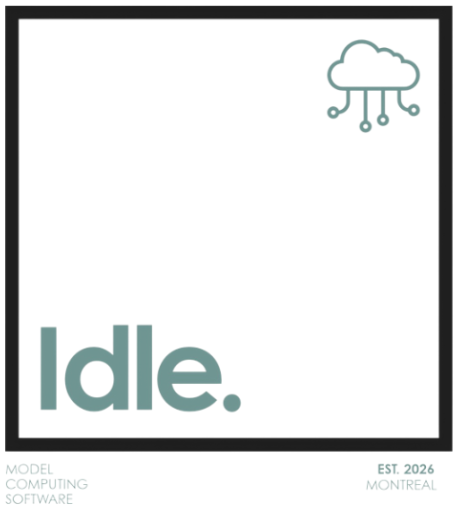
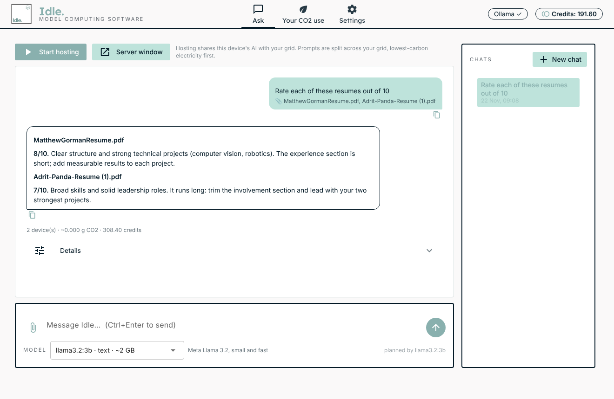
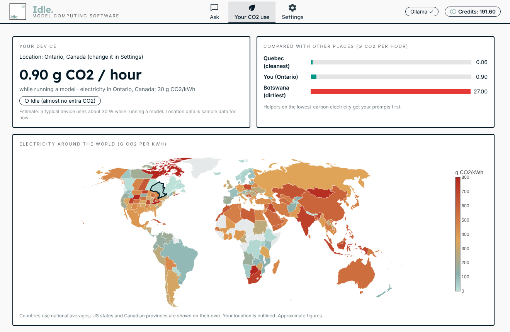
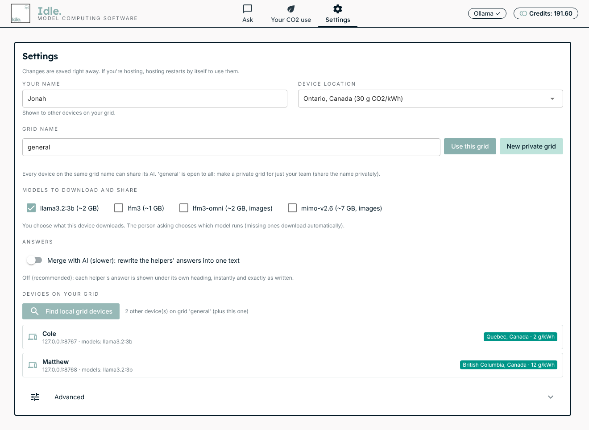

<p align="center"></p>

# Idle. Share your devices' AI, cleanest electricity first

Idle is a peer-to-peer AI app. Devices on the same network pool the AI models they run
locally with [Ollama](https://ollama.com). You type one prompt; Idle splits it into independent
parts, sends each part to the devices on the **lowest-carbon electricity**, and gives you back one
answer. Hosting earns credits, asking spends them, and Idle shows the CO2 your AI work uses.

No cloud and no API keys: every model runs on your team's own devices.

<p align="center"></p>

## Features

- **Chat with your grid.** Ask a question, attach files, get one answer. Past chats sit in a list
  down the side; open any chat to keep going.
- **Automatic splitting.** A short question goes to one device. A task with independent pieces
  (rate these two resumes, list 30 primes, summarize these documents) is split across several
  devices that work at the same time.
- **Carbon-aware routing.** Every device sets its location. Parts go to the devices on the
  cleanest electricity first, and your own device sits out if its electricity is the dirtiest.
- **Your CO2 use.** A world map of grid carbon intensity (countries, US states and Canadian
  provinces), your device's CO2 per hour while running a model, and this session's totals.
- **Credits.** Hosting earns credits and asking spends them, based on the tokens each model reads
  and writes.
- **Models, images and files.** Choose between `llama3.2:3b`, `lfm3`, `lfm3-omni` and `mimo-v2.6`;
  they download automatically. Attach PDFs, text files, and images (for the image models).
- **Grids.** Devices find each other by sharing a grid name (`general` by default, or a private
  name for your team), so nobody has to type IP addresses.
- **Built to keep going.** If a device drops out, its part goes to the next cleanest device. Busy
  ports, stuck servers and models that loop are handled for you.

## How it works

```
                        ┌──────────────── grid "general" ────────────────┐
  You: "Rate these      │                                                │
  two resumes"          │   Cole (Quebec, 2 g/kWh)     Matthew (BC, 12)  │
        │               │        ▲      │                  ▲      │      │
        ▼               │ part 1 │      │ answer    part 2 │      │      │
  ┌───────────────┐     │        │      ▼                  │      ▼      │
  │ Your device   │─────┼────────┴──────────────────────────┴─────────── │
  │ (Ontario, 30) │◀────┼──────────── answers come back ──────────────── │
  └───────────────┘     └────────────────────────────────────────────────┘
   count → plan → route → run in parallel → merge → one reply
```

1. **Find** the devices on your grid (each one posts its address under the grid name).
2. **Count**: your device's coordinator model (`llama3.2:3b`) works out how many independent
   pieces the task has. It isn't told how many devices exist, so it doesn't split just because it can.
3. **Plan**: it writes one self-contained instruction per piece, e.g. "Rate MatthewGormanResume.pdf
   out of 10". It never answers the task itself.
4. **Route** (in code, not by the AI): the parts go to the devices with the lowest g CO2/kWh. Each
   helper gets only the files its part names.
5. **Run**: all parts run at the same time, on the model you chose.
6. **Merge**: each helper's answer appears under its own heading, instantly and exactly as written
   (or, with *Merge with AI*, your device rewrites them into one text).

## Quick start

Do this on **every** device (Windows, Mac or Linux).

1. **Install Python 3.11 or newer** from <https://www.python.org/downloads/> (on Windows, tick
   *Add Python to PATH*).
2. **Install Ollama** from <https://ollama.com/download> and open it once. Keep it up to date: the
   newer models need a recent version.
3. **Get Idle and its three extras:**
   ```bash
   git clone -b claude/fervent-bell-sskzyv https://github.com/jonahk3/IdleAI.git
   ```
   ```bash
   cd IdleAI
   ```
   ```bash
   python3 -m pip install nicegui pywebview pypdf
   ```
4. **Start the app:**
   ```bash
   python3 -m peer.app
   ```
   It opens in its own window. (On Windows, type `python` instead of `python3`.)
5. In **Settings**, set your name and **device location**, and keep the grid name `general` (or
   type your team's private grid name).
6. On the devices that will share their AI, press **Start hosting** on the Ask page. Then type a
   prompt on any device.

The first prompt downloads `llama3.2:3b` (about 2 GB) if this device doesn't have it yet.

## Using the app

### Ask
- Type a message (Ctrl+Enter sends). Add files with the 📎 button. Choose the helpers' model under
  the message box.
- While it works, the reply shows what's happening: finding devices, planning, working on N parts,
  merging. Below each reply: how many devices helped, the estimated CO2, the credits spent, a copy
  button, and **Details** (which device and model did each part, and the full log).
- **Chats** run down the right side. *New chat* starts one; click a chat to open it and add to it.
- **Start hosting** shares this device's AI with your grid. **Server window** shows each task as
  it arrives, when it's finished and sent back, and the answer that was sent.

### Your CO2 use

<p align="center"></p>

Your device's CO2 per hour while running a model (its electricity's g CO2/kWh × about 30 W), a
comparison with the cleanest and dirtiest places, a world map coloured by grid intensity (with your
location outlined), and this session's totals.

### Settings

<p align="center"></p>

Your name, **device location** (search ~200 places), **grid name**, the models to download and
share, *Merge with AI*, and **Find local grid devices** (every device on your grid with its
address, location and models). *Advanced* has extra IPs and Wi-Fi search. If you're hosting,
changing a setting restarts hosting by itself.

## Models

The person asking picks the helpers' model; hosts only choose what they download. Planning and
merging always use `llama3.2:3b` on the asking device (the "coordinator").

| Model | Reads | Download | Notes |
|---|---|---|---|
| `llama3.2:3b` | text | ~2 GB | default; also plans and merges |
| `lfm3` | text | ~1 GB | tiny and fast |
| `lfm3-omni` | text + images | ~2 GB | |
| `mimo-v2.6` | text + images | ~7 GB | needs ~16 GB RAM |

The list is in `peer/config.py` (`MODELS`). Devices only ever run, or download, models on it.

## Attachments

- **PDFs**: their text is read (needs `pypdf`, the app offers to install it). Scanned PDFs (no
  selectable text) and password-protected ones are refused.
- **Text files** (txt, md, csv, json, html, code, ...) are added to the prompt.
- **Images** (png, jpg, webp, gif, bmp) need an image model (`lfm3-omni` or `mimo-v2.6`).
- Only the helpers get the files' contents. The planner only sees each file's name, type and length.

## Grids

Every device posts its address under its grid name on [ntfy.sh](https://ntfy.sh), a free public
message board, so devices on the same grid find each other without typing IPs. Everyone starts on
`general`. For a team-only grid press **New private grid** and share the name privately (anyone who
knows it can use your devices).

The devices still connect to each other **directly**, so they must be on the same network (the same
Wi-Fi or hotspot). Some networks block devices from reaching each other; a phone hotspot usually
works. Connecting devices on different networks would need a tunnel such as Tailscale (see Roadmap).

## Carbon-aware routing

- Each device's location comes from `peer/carbon_data.json`: approximate grid intensity for every
  Canadian province/territory, every US state, and national averages for ~130 countries.
- After the plan is made, parts go to the cleanest devices. A single part still leaves your device
  if a cleaner one is available; on a tie, your device keeps it (it's free).
- **If your device has the dirtiest electricity, it does no parts**, even if that means fewer parts.
- A device with no location is treated as the dirtiest, and the log says so.
- CO2 figures are estimates: about 30 W per device × time × grid intensity (`LAPTOP_WATTS`).

## Credits

- Hosting **earns** credits for each request you answer; asking **spends** them for each part
  another device answers. Work on your own device is free.
- 100 credits per 1,000 tokens (read + written). If a model doesn't report tokens: 300 credits per
  minute of compute. Every session starts with **500 credits**.
- It's a tracker for now: the balance resets when the app starts, can go negative, and never blocks
  anything. Accounts are on the roadmap.

## Command line

The app runs these same commands for you; you can also use them directly.

| Command | What it does |
|---|---|
| `python3 -m peer.app` | The Idle app (`--browser` to open it in your browser instead) |
| `python3 -m peer.server --name Bob --location QC --models llama3.2:3b` | Host: share this device's AI on your grid |
| `python3 -m peer.split "your prompt" --model lfm3 --file a.pdf` | Ask: split a prompt across your grid (`--ai-merge`, `--peers IP ...`, `--list`) |
| `python3 -m peer.chat --peer 10.0.0.5` | Chat directly with one device |
| `python3 -m peer.check 10.0.0.5` | Explain step by step why a device can't be reached |
| `python3 -m peer.room` | Make a random private grid name |
| `python3 -m peer.gui` | A simpler window that needs no extra installs |

`--room NAME` picks the grid in `peer.server` and `peer.split` (remembered; default `general`).
Locations are codes: `QC` (Canadian province), `US-CA` (US state) or `FRA` (country).

## Settings in `peer/config.py`

| Setting | Default | What it controls |
|---|---|---|
| `MODELS` / `DEFAULT_MODEL` | 4 models / `llama3.2:3b` | The models devices may run |
| `COORDINATOR_MODEL` | `llama3.2:3b` | The model that counts, plans and (optionally) merges |
| `ANSWER_OPTIONS` | repeat penalty, 1,200-token cap | Stops models looping or rambling |
| `MAX_CONTEXT` | 32,768 tokens | The most a model may read at once (sized per request) |
| `COMBINE_MAX_TOKENS` / `PLANNER_MAX_TOKENS` | 700 / 800 | Length caps for *Merge with AI* and the planner |
| `CREDITS_PER_1000_TOKENS` / `CREDITS_PER_MINUTE` / `STARTING_CREDITS` | 100 / 300 / 500 | Credits |
| `LAPTOP_WATTS` | 30 | Power assumed for CO2 estimates |
| `PEER_PORT` | 8765 | The server's port (a busy port moves to 8770+) |

The prompts given to the models (count, plan, helper, merge) are all in `peer/prompts.py`.

## Troubleshooting

| Problem | Fix |
|---|---|
| A device isn't found | Is it hosting, on the **same grid name** and the same network? Press **Find local grid devices** in Settings, or run `python3 -m peer.check <its IP>`. University Wi-Fi often blocks devices from seeing each other: try a phone hotspot. |
| `Couldn't read/post to the grid` | The device can't reach ntfy.sh (no internet, or the Wi-Fi login page isn't done). Devices added under *Advanced > Extra IPs* still work. |
| The firewall asks about Python | Allow it. On Windows tick **Private and Public** networks. |
| My device did a part even though it's dirty | Check every device has a location set (Settings) and has run `git pull`. A device with no location counts as the dirtiest. |
| An answer seems to have missed part of a file | Idle sizes the model's reading window per request and sends helpers only their files; files longer than `MAX_CONTEXT` still get cut, and the log warns you. |
| `token repeat limit reached` in a server window | The model looped and Ollama stopped it. Idle keeps the answer up to that point and removes the repetition. |
| `Ollama not running` in the header | Open the Ollama app. |
| A model won't download | Update Ollama (<https://ollama.com/download>); newer models need a newer version. |

## Safety and limitations

- Ollama itself is never exposed to the network: only Idle's server is, and it only answers chat
  requests for models on the allowlist. Nothing received over the network is ever run as code.
- Anyone on the same grid name and network can send prompts to a hosting device. Use a private grid
  name for your team.
- Devices must be on the same network (see *Grids*).
- Each message in a chat is answered on its own: the models don't see earlier messages yet.
- Location data is approximate sample data, and CO2 figures are estimates.
- Small local models make mistakes; check important answers.

## Project layout

| File | What it does |
|---|---|
| `peer/app.py` | The Idle app (NiceGUI): chat, CO2 tab, settings |
| `peer/api.py` | The engine behind the app: runs the commands and reads their output (`python3 -m peer.api` serves it as a local web API) |
| `peer/split.py` | Asking: find devices, count, plan, route, run in parallel, merge |
| `peer/server.py` | Hosting: answers requests from other devices with this device's Ollama |
| `peer/prompts.py` | Every instruction given to the models |
| `peer/carbon.py`, `peer/carbon_data.json` | Grid carbon intensity by place, and CO2 estimates |
| `peer/credits.py` | How many credits a piece of work earns or costs |
| `peer/room.py` | Grid names: posts and reads device addresses on ntfy.sh |
| `peer/attachments.py` | Reads PDFs, text files and images |
| `peer/ollama.py` | Talks to this device's Ollama (downloads, context sizing, loop handling) |
| `peer/chat.py`, `peer/check.py` | Chat with one device; diagnose an unreachable one |
| `peer/discovery.py`, `peer/ports.py` | Wi-Fi search; picking a free port and clearing stuck servers |
| `peer/gui.py`, `peer/settings.py`, `peer/config.py` | The simple window; saved settings; configuration |
| `peer/assets/` | Logo, icon and map outlines |

## Roadmap

- **Accounts**, so credits carry over between sessions and devices.
- **Live carbon data** (e.g. Electricity Maps) instead of sample figures, and verified locations.
- **Devices on different networks**, through a tunnel such as Tailscale.
- **Chat memory**, so follow-up questions can use earlier messages.
- **Batch jobs**: a CSV plus a prompt, with rows shared out across the grid.

## Credits for bundled data

- Map outlines: [Natural Earth](https://www.naturalearthdata.com/) (public domain), simplified into
  `peer/assets/world_map.geojson`.
- `peer/assets/topojson/world_110m.json`: from [plotly.js](https://github.com/plotly/plotly.js) (MIT
  licence), bundled so the map works offline.
- Grid carbon intensities in `peer/carbon_data.json` are approximate, rounded sample figures.

Built at McGill CodeJam, Montreal, 2026.
